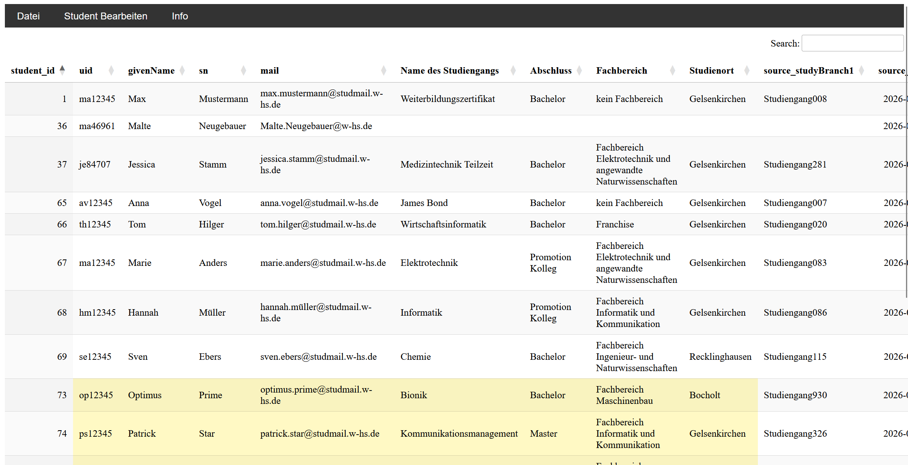
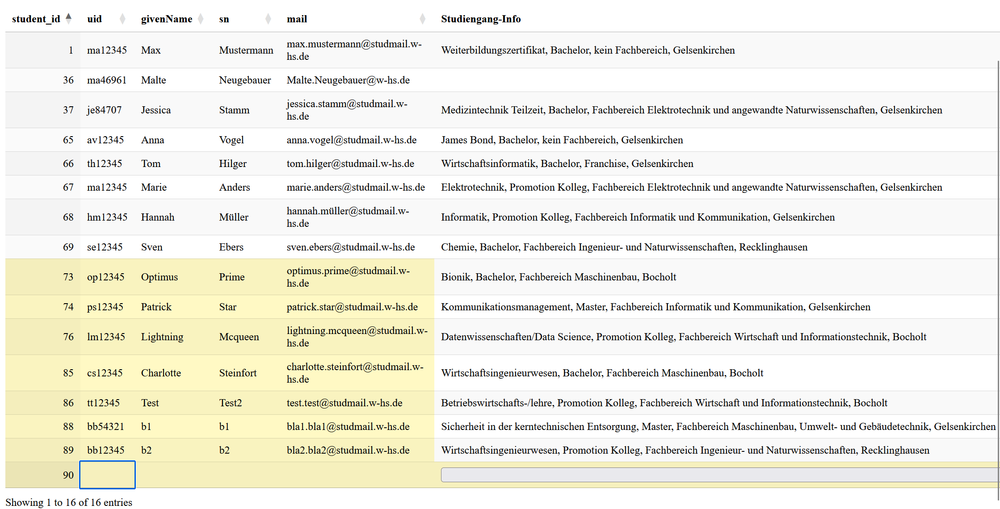
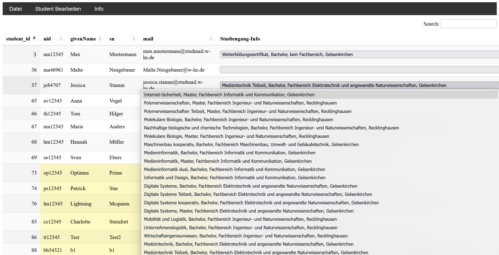
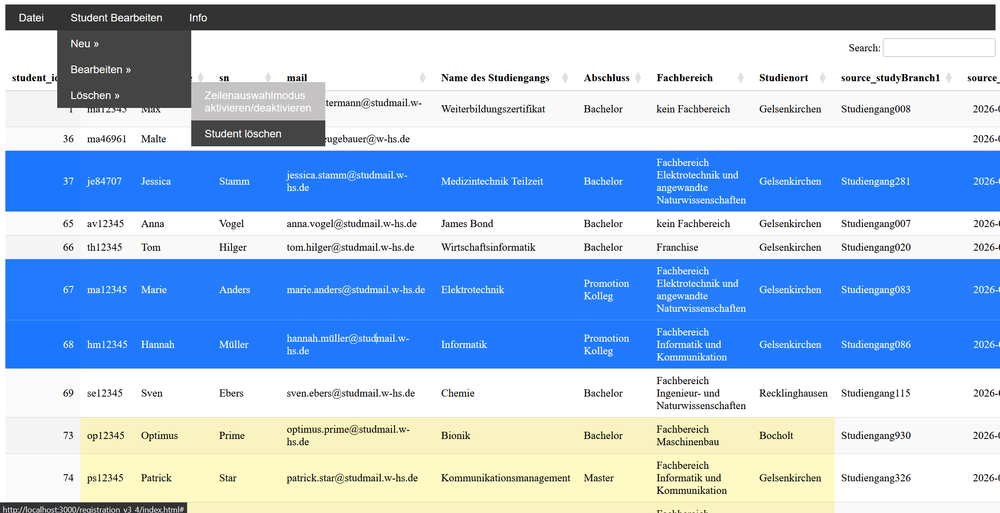

# Datatable
Eine Webbasierte Anwendung zum Verwalten von Studentendaten.

Die Webanwendung basiert auf den Daten einer MariaDB. Diese enthält die folgenden Tabellen:
* studiengangsliste: Enthält alle Studiengänge, welche die WHS anbietet (ein paar sind fiktional)
* students_initial: Enthält Studentendaten (ebenfalls fiktional)
* moderator_overrides: Enthält die von Mitarbeitern bzw. Moderatoren überschriebene Studentendaten
Sämtliche Studentendaten, die vom Moderator überschrieben oder neu erstellt wurde, werden in der Anwendung als gelb hinterlegt. Das soll verdeutlichen, dass es sich dabei nicht länger um die Originaldaten handelt.

Die Webanwendung bildet die Schnittstelle für die Moderatoren die Studentendaten zu bearbeiten. Bearbeiten meint ...
* insert
* update
* delete
Desweiteren gibt es die Funktionalität den Inhalt des JavaScript DataTable als XLSX und CSv zu exportieren. Für diese Bearbeitung (insert, update, delete) gibt es drei unabhängig voneinander funktionierende Bearbeitungsmodi, welche über das Menü aktiviert werden können. Die folgenden drei Screenshots verdeutlichen die Modi und somit die Arbeit mit der Webanwendung.

Hier können Moderatoren beliebig viele Zeilen bzw. Studenten anlegen. Die Zusammenlegung der vier Spalten "Name des Studiengangs", "Abschluss", "Fachbereich", "Studienort" können dessen Inhalte durch eine einzige Dropdown-Box ausgewählt werden. Durch Klick auf das Untermenü "Neuen Studenten speichern" werden die Änderungen an die DB geschickt.

Hier können die Studentendaten bearbeitet werden. Durch Klick auf das Untermenü "Änderungen an Student speichern" werden diese an die DB weitergereicht.

Hier können Zeilen bzw. Studenten ausgewählt werden, welche gelöscht werden sollen. Durch Klick auf das Untermenü "Student löschen" werden diese auch aus der DB gelöscht.

## Frameworks
* JavaScript DataTable (für das Frontend)
* PHP Laravel als Standalone (für das Backend)
    * Capsuel zur Verbindung mit der MariaDB
    * Query Builder zum Ausführen von DB-Transaktionen

Zum Ausführen des Projektes wurde die VS Code Erweiterung "PHP Server" verwendet.